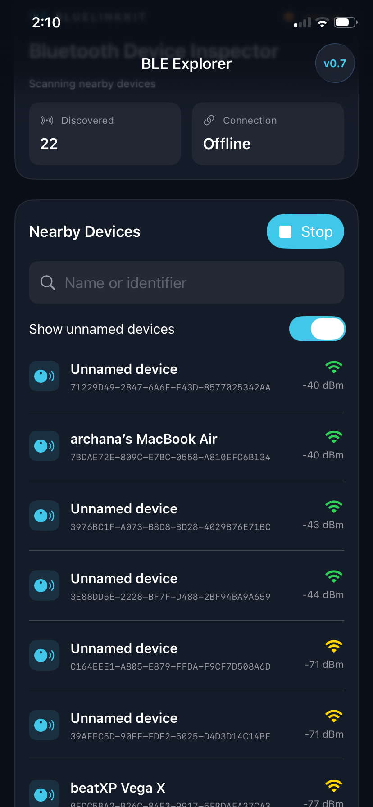
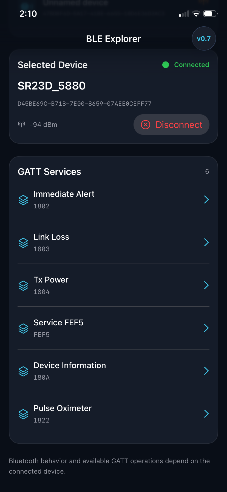
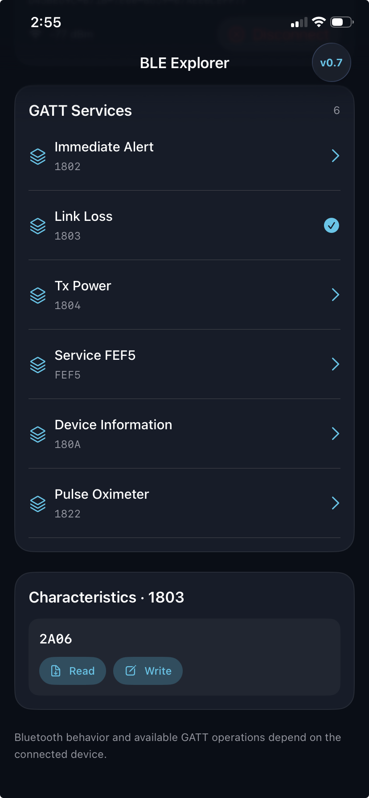

# BlueLinkKit 0.7.0

Swift package + polished SwiftUI BLE Explorer demo (iOS 16+).

## Open the demo
Open `Examples/BLEExplorerApp.xcodeproj` in Xcode, select the BLEExplorerApp scheme, configure signing, and run on a physical iPhone. Grant Bluetooth permission.

## Explorer UI
Dark dashboard, nearby device search, scan/stop, signal strength, connection state, service and characteristic browsing, read/notify/write, HEX payload inspector and live packet list.

## Important
This release updates the demo UI, not the underlying BLE SDK. Test on real BLE hardware; Xcode/iOS compilation has not been performed in this Linux environment.

## Screenshots

| Device Scanning | Device Connected | GATT Services |
|---|---|---|
|  |  |  |

## Demo Video

[Watch the BlueLinkKit BLE Explorer Demo](docs/demo/bluelinkkit-demo.mp4)

The demo shows BlueLinkKit running on a physical iPhone, discovering BLE peripherals, connecting to a device and exploring GATT services.
  
